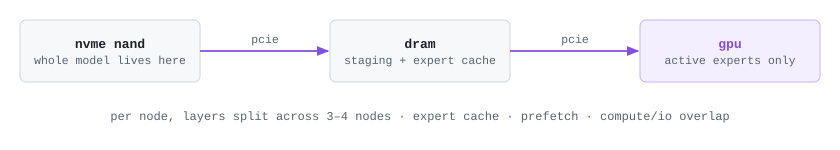

# llama.cpp-moe-streaming

my senior thesis at princeton, advised by david wentzlaff: run trillion-parameter mixture-of-experts models on a few ordinary pcs. the whole model stays on nvme flash, and each token pulls in only the experts it actually uses. built on [llama.cpp](https://github.com/ggml-org/llama.cpp).

**status: setting up.** nothing in this fork differs from upstream yet. this page is the plan, and results will show up here as they come in.

<picture>
  <source media="(prefers-color-scheme: dark)" srcset="docs/thesis/overview-dark.svg">
  
</picture>

## the problem

a trillion parameters at 4 bits is about 500 gb of weights. one of these nodes has 12 gb of vram and 32 gb of ram, so nearly all of the model has to live on flash. an moe only routes each token through a few experts, so decode doesn't need every weight, just the active experts that aren't already sitting in ram or vram. that makes decode a flash-bandwidth problem:

```math
\text{tokens/s} \;\lesssim\; \frac{B_{\text{flash}}}{(1 - h)\, S_{\text{active}}}
```

- $S_{\text{active}}$: bytes of expert weights one token touches
- $h$: the fraction of those already cached in ram or vram
- $B_{\text{flash}}$: how fast a node can read from its nvme drives

my bandwidth model puts sequential decode at around **1.5 tok/s** on this hardware. the goal is to get past **10**.

## what this fork will change

each change goes after one term of that bound.

| change | what it moves |
| --- | --- |
| an expert cache across ram and vram that keeps hot experts resident | raises $h$ |
| prefetching experts for upcoming layers | hides flash latency |
| overlapping compute with io | the gpu stops waiting on reads |
| reading three gen5 nvme drives per node in parallel | raises $B_{\text{flash}}$ |
| splitting layers across nodes (pipeline parallel) | each node stores and streams only its slice |

## hardware (planned, 3–4 nodes)

| per node | |
| --- | --- |
| cpu | ryzen 5 7600x (zen 4, avx-512) |
| gpu | rtx 5070 12 gb, pcie x16 |
| ram | 32 gb ddr5-6000 |
| flash | 3 × 1 tb pcie gen5 nvme |

the small amount of ram is on purpose. the model can't hide in dram, so the results measure the flash tier, not memory capacity. the 5070 won out over the 16 gb 5060 ti because it gets a full x16 link, which matters when every expert crosses pcie.

## how it'll be measured

- **baseline:** stock llama.cpp on the same nodes with the same model. that isolates what these changes buy.
- **comparison:** [strata](https://github.com/Niko1221/Strata), a hybrid vram / ram / ssd moe engine. its test machine is almost identical to one of these nodes.
- **metric:** sequential decode tok/s, with each change turned on one at a time.

## results

none yet.

## the code

once there's something to show, [this compare view](https://github.com/ggml-org/llama.cpp/compare/master...aarushgoradia:llama.cpp-moe-streaming:thesis) shows only what this fork changes. everything else is stock llama.cpp. see the [upstream readme](https://github.com/ggml-org/llama.cpp#readme) for building and running it.
